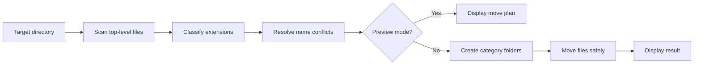

<div align="center">

# 🧹 CleanFolder

### A safe and customizable file organizer built with Python

Turn cluttered directories into clean, predictable folder structures — directly from the command line.

[](https://github.com/linkoro57/Clean-Folder/actions/workflows/tests.yml)
[](https://github.com/linkoro57/Clean-Folder)
[](https://www.python.org/downloads/)
[](pyproject.toml)
[](LICENSE)

[Quick start](#-quick-start) · [Organization pipeline](#-organization-pipeline) · [Categories](#-categories) · [Configuration](#️-configuration) · [Library API](#-library-api) · [Tests](#-tests)

</div>

> [!IMPORTANT]
> Start with `--preview` when organizing an important directory. CleanFolder never overwrites an existing file, but reviewing the generated plan is always recommended.

## ✨ Highlights

| 🔎 Safe preview | 🗂️ Smart classification | 🛡️ Conflict protection |
| :--- | :--- | :--- |
| Inspect every planned operation before any file is moved. | Sort files by extension into clear, purpose-built categories. | Existing files are preserved using automatic numbered suffixes. |

| ⚙️ Custom rules | 📦 Zero dependencies | 🧪 Fully tested |
| :--- | :--- | :--- |
| Load your own categories and fallback folder from a JSON file. | Runs entirely on the Python standard library. | Classification, configuration, conflicts, preview, and moves are covered by tests. |

## 🚀 Quick start

### 1. Install

```bash
git clone https://github.com/linkoro57/Clean-Folder.git
cd Clean-Folder
python -m pip install .
```

For local development, install the project in editable mode:

```bash
python -m pip install -e .
```

### 2. Preview

```bash
# Linux and macOS
cleanfolder ~/Downloads --preview

# Windows PowerShell
cleanfolder "$HOME\Downloads" --preview
```

Without installation, replace `cleanfolder` with `python cleanfolder.py`.

### 3. Organize

```bash
cleanfolder ~/Downloads
```

When no directory is provided, CleanFolder organizes the current working directory:

```bash
cleanfolder
```

## 🧱 Organization pipeline



Planning and execution are separate. Preview mode uses the exact same plan as a real run without modifying the filesystem.

## 📁 Categories

| Folder | Example formats | Purpose |
| :--- | :--- | :--- |
| `Images` | PNG, JPG, SVG, WebP | Pictures and graphics |
| `Documents` | PDF, DOCX, XLSX, TXT | Documents and office files |
| `Archives` | ZIP, RAR, 7Z, TAR | Compressed packages |
| `Installers` | EXE, MSI, DMG, APK | Applications and installers |
| `Audio` | MP3, WAV, FLAC | Music and audio files |
| `Videos` | MP4, MKV, MOV | Video content |
| `Code` | Python, Luau, JS, HTML | Source code and data formats |
| `Other` | Any unknown extension | Unclassified files |

```bash
cleanfolder ~/Downloads
cleanfolder ~/Desktop --preview
cleanfolder . --include-hidden
```

> [!TIP]
> Existing directories are never scanned recursively. CleanFolder only processes files located directly inside the selected directory.

## ⚙️ Configuration

Create custom sorting rules with a JSON file:

```json
{
  "fallback_category": "Other",
  "categories": {
    "Pictures": ["png", "jpg", "jpeg", "webp"],
    "Documents": ["pdf", "docx", "txt"],
    "Archives": ["zip", "rar", "7z"]
  }
}
```

Then pass it to the command:

```bash
cleanfolder ~/Downloads --config config.example.json --preview
```

Extensions are case-insensitive and may be written with or without a leading dot. Files that do not match a rule are sent to `fallback_category`.

## 🐍 Library API

```python
from pathlib import Path

from cleanfolder import Organizer, OrganizerConfig

config = OrganizerConfig(include_hidden=False)
organizer = Organizer(config)

# Build and inspect the operation without changing files
preview = organizer.run(Path.home() / "Downloads", preview=True)
print(f"Planned moves: {preview.moved}")

# Apply the same organization rules
result = organizer.run(Path.home() / "Downloads")
print(f"Moved files: {result.moved}")
```

| Component | Responsibility |
| :--- | :--- |
| `OrganizerConfig` | Stores default or custom sorting rules |
| `FileClassifier` | Maps extensions to categories |
| `MovePlanner` | Creates a deterministic, non-destructive move plan |
| `MoveExecutor` | Creates folders and performs safe moves |
| `OrganizationResult` | Exposes moved and skipped file counts |

## 🏗️ Project architecture

```text
CleanFolder/
├── cleanfolder/
│   ├── core/
│   │   ├── classifier.py
│   │   ├── conflicts.py
│   │   ├── executor.py
│   │   ├── organizer.py
│   │   └── planner.py
│   ├── models/
│   │   ├── move.py
│   │   └── result.py
│   ├── reporting/
│   │   └── console.py
│   ├── cli.py
│   ├── config.py
│   ├── constants.py
│   └── exceptions.py
├── docs/
├── tests/
├── cleanfolder.py
├── config.example.json
└── pyproject.toml
```

See [Architecture](docs/architecture.md) and [Configuration](docs/configuration.md) for additional details.

## 🧪 Tests

```bash
python -m unittest discover -s tests -v
```

GitHub Actions tests every push and pull request on Python 3.10, 3.11, 3.12, and 3.13.

## ⚠️ Scope and limitations

- CleanFolder organizes top-level files only; it does not traverse existing directories.
- Categories are based on file extensions, not file content inspection.
- Preview reflects the filesystem state at the moment the plan is created.
- Moving files across different drives may take longer because the operating system must copy them first.
- CleanFolder does not provide an automatic undo operation.

## 📄 License

Distributed under the [GNU General Public License v3.0](LICENSE).

<div align="center">

**Organize the clutter. Keep the control.**

</div>
